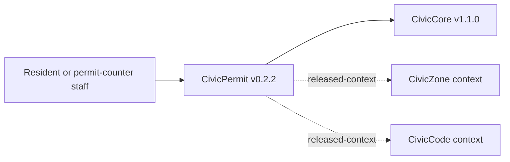

# Townlight Permitting — User manual

## Private beta candidate — 29 October 2026

This guide now includes the local, unpublished corrected candidate. Use `Townlight-beta-corrected-private.msi`, version 1.6.0.1, SHA256 `98bcdef11ebdf5c767f620c904ff49f85115fde3b5c23f62703b111e645aaf86`. Historical public release links below identify earlier compositions; they are not the download instructions for this candidate. The current owned code is AGPL-3.0-only; retain third-party and historical notices.

For the full eight-module desktop choose **Townlight Inspections candidate** (`inspections-preview`) during normal first-run. This profile includes Core, Records, Meetings, Code, Zoning, Planning, Permitting and Inspections, plus supporting Notice and Access. Create the city profile and named administrator, sign in, choose backup storage, and use **Continue without local AI** for the deterministic staff workflows. Run Health Check, then Open Townlight. In System Health use **Finish Records Migration** to activate the canonical Python/PostgreSQL services. Add named staff through Settings. Station is provisioned separately; it does not replace or configure standalone CivicCast.

The private handoff contains the exact candidate identity, per-product receipt matrix and evidence limits. No city data or credentials were used. The tests drive the installed app's native commands and selected real UI controls; this is not a claim that every field, role, vendor or legal workflow has been tested. The source companion accompanying the MSI remains the source for the signed bytes; these later manual edits are a separate documentation companion.

### Permitting operator update

The imported requirement original backs each displayed material, pathway step and typical time. Update through a new reviewed requirement revision; stale heads are refused. A fee_link can display cited source text from a configured public source. The software does not calculate authoritative fees, issue permits or collect payments. Save the intake, record staff review, inspect the separate Records copy and explicitly attach it.

Historical published baseline reviewed 2026-10-26; current private-candidate instructions above.

[Product page](https://townlight.github.io/products/permitting/) · [Overall manual](https://github.com/townlight/townlight/blob/main/USER-MANUAL.md) · [Requirements assessment](https://github.com/townlight/townlight/blob/main/docs/assessment/feature-and-integration-review.md)

## Purpose and audience

Permitting supports pre-application and intake preparation. The city’s permitting system remains the system of record. A material assessment is staff work, not an official completeness decision.

Primary operators: **Permit intake and development-review staff**. [Release and acceptance notes](https://github.com/townlight/townlight/releases/tag/townlight-records-meetings-code-zoning-planning-permitting-v1.6.0-beta.1).

## Before starting

Use the explicit product composition in the installed Townlight desktop. Sign in with the required local staff account, confirm System Health readiness and take a backup before maintenance. If a workspace is absent, inspect the profile and release identity before importing data. Optional AI is not needed for the accepted deterministic workflow. The procedures below use real saved sources; sample/demo web pages are not substitutes.

## Complete the workflow

### 1. Enable the composition

Use the private candidate and full Inspections composition described above. Open Permitting after normal activation/migration; optional AI is not required for the deterministic intake workflow. The separate historical Permitting installer is not required.

### 2. Import requirements

Open Permitting → Requirement library. Select the complete JSON RequirementBundle, inspect jurisdiction, project type, effective/source dates, original filename/hash and material citations, then confirm. Later revisions under an existing ID require the current revision and preserve history.

### 3. Prepare the case

Start an intake case with the selected requirement revision. Enter project, location, applicant contact and assigned staff. Assess each required material as not reviewed, provided, missing or unclear. Keep private staff notes and the full proposal separate from the public summary.

### 4. Select cited context

Search actual Code and Zoning sources and select exact public versions. The trusted provider and expected SHA256 are rechecked on search, save and export. Unavailable evidence never substitutes sample text or stale cached authority.

### 5. Save and review

Save intake draft, reopen it and reconcile revision conflicts explicitly. Use Record staff review with review notes. The reviewer and date are derived from the signed-in persisted account; editable names cannot impersonate a reviewer. Changes produce a new draft.

### 6. Inspect both audiences

Create a private staff packet, or write/review a separate public summary and Preview Records copy. The public copy excludes applicant contact, location, proposal, material notes and private staff notes. Inspect the resulting citations and content before creating or saving it.

### 7. Attach explicitly

Save the exact hash-checked copy or attach it to an existing Records request. Inspect the resulting attachment in Records. It must not approve, fulfill or release the request. Records later rechecks source permission and hash under its own release workflow.

## How this product connects

Permitting consumes Core, Code and Zoning, and sends a reviewed copy to Records. The release does not connect every permitting vendor or automatically create an Inspections case.

## Boundaries and known gaps

No permit issuance, fee collection, inspection scheduling, official entitlement determination, public applicant portal or live permit-system writeback is provided. Read-only vendor status mirroring and hearing-notice integration from the broader catalog have not been established by the installed acceptance.

## Shared operating rules

Use the installed native desktop for the accepted workflow. Standalone package web pages, sample endpoints and developer API examples are different surfaces. A local Resident/Public view is not an internet deployment. Confirm the selected composition before looking for a workspace.

1. Keep named staff accounts and least privilege. Administrators manage setup; ordinary staff use their authorized workspace. Do not put credentials, unredacted evidence or resident data into public issues.
2. Preserve originals and their hashes. Import preview and confirmation are distinct actions. Treat fictional fixtures as fictional; they are not municipal authority.
3. Save before navigating away, closing or signing out. Unsaved drafts are not a durable record. On a conflict, reopen and reconcile; on an unknown result, inspect the saved record before repeating a write.
4. Review the exact revision and audience. A private packet and a public copy are different artifacts. Public text is explicitly edited/reviewed; changing a filename does not sanitize private content.
5. Keep source permission, version and hash checks. If a provider is stopped or a source becomes restricted, retain the draft, restore authorized access and deliberately reselect evidence. Never bypass the check or substitute a sample.
6. Approval, attachment, export and publication are separate actions. No cross-product attachment is an automatic records response, official permit, legal determination or enforcement decision.

## Installation, maintenance and recovery

For this private candidate use the exact installer and checksum above. Verify its publisher signature and handoff before installation; do not infer upgrade compatibility from its version. The public release references describe historical, separately identified compositions.

Complete Setup and normal runtime activation for the selected composition. Optional local AI can be deferred. Use System Health to distinguish stopped, starting, ready and failed dependencies. Wait for readiness before opening a dependent workspace. Use documented Retry controls after recovery; do not repeat business writes to refresh a stale screen.

Back up through the canonical desktop controls before migration or maintenance. Keep the coherent data, document and profile backup and its receipt in protected storage. A source export is not a full backup. Stop dependent services before PostgreSQL maintenance. Restore through the supported controls rather than editing SQL or restoring historical JSON into the active runtime. Uninstall can retain data; backup before uninstalling and inspect the chosen removal options. Never assume uninstall means data deletion.

For an error, retain the message, time, selected profile, installed version and operation; inspect System Health and relevant logs. Use a redacted support bundle. Do not delete the profile, run an arbitrary downgrade or repair prerequisites as a first response. If an installer requests a restart, save work and obtain the operator’s explicit restart decision before proceeding.

## Evidence and scope

The current normal-profile Sandbox acceptance covers first-run, named staff identity, the selected installed product workflows and coherent backup/restore. The handoff matrix links the exact raw receipts and distinguishes earlier unchanged source/media evidence. This is fresh-install acceptance of the identified private candidate; historical upgrades, every screen/role/vendor and city equipment are not certified. See the local beta handoff and current manual index; public documentation below is historical.


## Maintainer and API reference

The following source contracts support these instructions. The historical reference below retains older API/setup details for their original version; it does not override this operating guide or the release acceptance.

- [civicpermit/workflow_models.py](https://github.com/townlight/permit/tree/main/civicpermit/workflow_models.py)
- [civicpermit/workflow_store.py](https://github.com/townlight/permit/tree/main/civicpermit/workflow_store.py)
- [civicpermit/connections.py](https://github.com/townlight/permit/tree/main/civicpermit/connections.py)
- [civicpermit/records_export.py](https://github.com/townlight/permit/tree/main/civicpermit/records_export.py)
- [docs/connected-workflow.md](https://github.com/townlight/permit/tree/main/docs/connected-workflow.md)


---

## Historical package/API reference

The material below is retained from the previous manual for historical and developer reference. Version, unreleased, sample, planned and installation claims below describe that earlier document, not current desktop release status. Use the current guide above for operation. Existing detailed API reference remains useful only for the matching package/version.

<a id="civicpermit-user-manual"></a>

# Townlight Permitting User Manual

## For Residents And Municipal Decision-Makers

Townlight Permitting helps cities give applicants clearer pre-application guidance before a formal permit submittal. It can show requirement context, highlight missing or unclear intake materials for staff review, route deficient persisted intakes to a staff-only queue, and produce records-ready permit-intake exports.

Current state: v0.2.2 corrective demotion state. The previous v1.0.0 release was published in error. This narrow truth-repair release is no functional upgrade; it exists solely to supersede the false v1.0.0 release from 2026-05-21 in GitHub's Latest impression, with the Townlight Core pin unchanged. The module includes deterministic sample checks, optional database-backed requirement and intake records, staff review queue workflows, review-required CivicZone/CivicCode context packet support, adversarial local integration mocks, Townlight Core v1.1.0 release-wheel alignment, staff-only persisted intake create/read routes, and a public sample UI at `/civicpermit`.

Townlight Permitting does not provide legal advice, permit approvals, official completeness determinations, fee calculations, inspections, live GIS, live LLM calls, permit-system writeback, or final staff approval.

## For IT And Technical Staff

Townlight Permitting is a FastAPI Python package pinned to the published `CivicCore v1.1.0` release wheel. The current runtime exposes:

- `GET /`
- `GET /health`
- `GET /civicpermit`
- `POST /api/v1/civicpermit/requirements/lookup`
- `POST /api/v1/civicpermit/context/development-review`
- `POST /api/v1/civicpermit/integrations/mock/development-review`
- `POST /api/v1/civicpermit/intake/review`; persisted records require `X-CivicPermit-Role: staff` and `X-CivicPermit-Staff-Key` when `CIVICPERMIT_INTAKE_DB_URL` is configured
- `GET /api/v1/civicpermit/intake/{intake_id}` when `CIVICPERMIT_INTAKE_DB_URL` and `CIVICPERMIT_STAFF_API_KEY` are configured and both staff headers are present
- `POST /api/v1/civicpermit/staff/reviews`
- `GET /api/v1/civicpermit/staff/reviews`
- `PATCH /api/v1/civicpermit/staff/reviews/{review_id}`
- `GET /api/v1/civicpermit/staff/reviews/summary`
- `POST /api/v1/civicpermit/submittal/outline`
- `POST /api/v1/civicpermit/export`

Set `CIVICPERMIT_INTAKE_DB_URL` to persist permit requirement, intake review, and staff queue records. Persisted staff routes require `CIVICPERMIT_STAFF_API_KEY`, `X-CivicPermit-Role: staff`, and matching `X-CivicPermit-Staff-Key` from a trusted staff workflow. Townlight Permitting uses Townlight Core `staff_key_gate` for timing-safe key comparison. Leave it unset for deterministic sample behavior.

Run local verification with:

```powershell
python -m pip install https://github.com/CivicSuite/civiccore/releases/download/v1.1.0/civiccore-1.1.0-py3-none-any.whl
python -m pip install -e ".[dev]"
python -m pytest -q
bash scripts/verify-release.sh
```

## Architecture



Townlight Permitting depends on Townlight Core. Townlight Core does not depend on Townlight Permitting. Townlight Permitting v0.2.2 uses deterministic sample requirement data plus optional staff-gated persistence, review-required context packets for released CivicZone/CivicCode references, staff review queue records, and adversarial local mocks for integration-depth validation.
